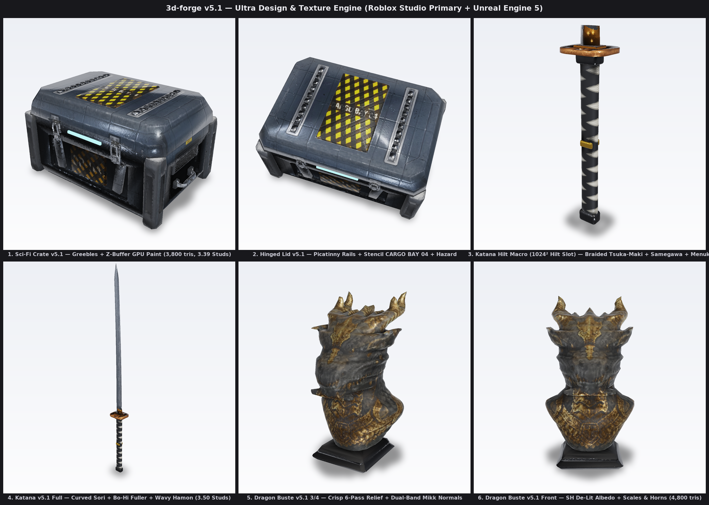
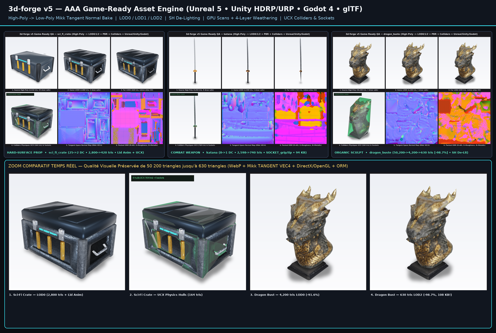
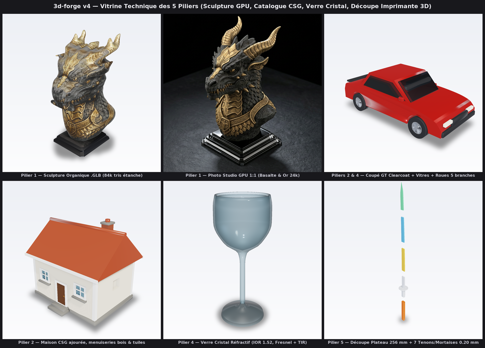
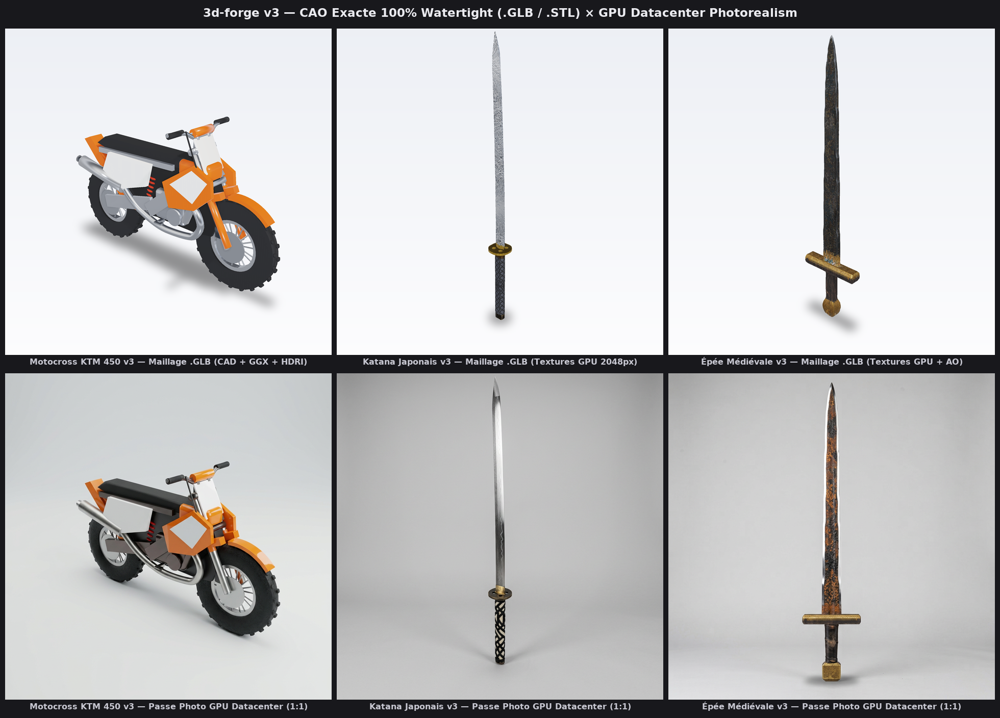
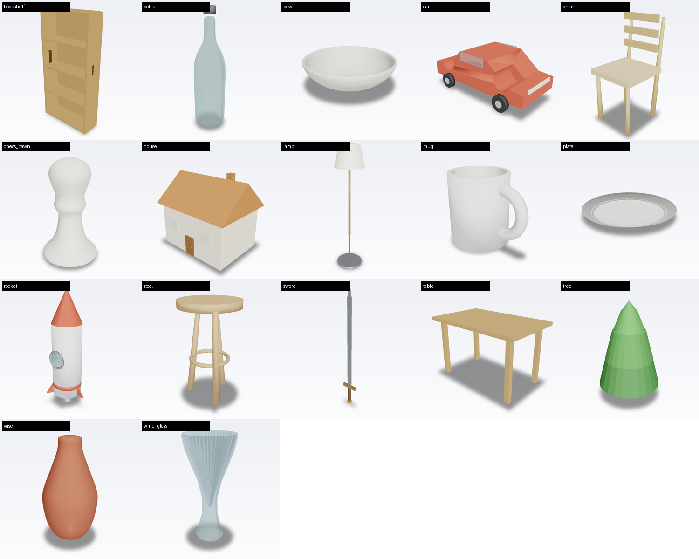

# 3d-forge v5.1 🎮🟥⚔️🐉✨

**Moteur Ultra Design & Texture PBR photoréaliste pensé en priorité pour Roblox Studio (`SurfaceAppearance` Dual-`1024²` + `Studs` + `< 10k tris` + `Neon` + `Luau`) et Unreal Engine 5 (`Lumen` + `ORM` + `DirectX -Y` + `UCX_*`) — propulsé par Kitbash Mécanique Hard-Surface (`greebles.py`) + Peinture Multi-Vues GPU Z-Buffer (`gpu_bridge.py`) + Sculpture Organique GPU (`gpu_sculpt.py`), zéro GPU requis côté utilisateur.**



## 🤖 Prompt pour Agents IA (`Arena / GLM / Claude / Cursor / Codex`)

Copie-colle simplement ce bloc dans ton Agent IA (bouton **📋** en haut à droite) et remplace la dernière ligne *(voir aussi [`PROMPT_AGENT_IA.md`](PROMPT_AGENT_IA.md) ; [`AGENTS.md`](AGENTS.md) et [`CLAUDE.md`](CLAUDE.md) sont également chargés automatiquement si tu connectes le repo)* :

```markdown
Utilise le skill 3D de ce dépôt GitHub : https://github.com/DimalaxYT/3F
1. Clone le dépôt (s'il n'est pas déjà présent) et vérifie les dépendances de `requirements.txt`.
2. Lis impérativement `SKILL.md` et `AUTOCRITIQUE.md` avant de commencer.
3. Crée l'objet suivant avec `3d-forge v5.1` (en utilisant `scripts/turbo_forge.py` avec `meshkit.py` + `greebles.py` si c'est mécanique/architectural, ou `gpu_sculpt.py` si c'est une sculpture organique, + `--split-bed` via `scripts/split_stl.py` s'il dépasse 256×256×256 mm) et livre-moi les `.glb` (standard + Roblox Studio + UE5), le `.stl` 100 % étanche, le `preview.html` interactif et le rendu studio :

Objet demandé : [ÉCRIS TON IDÉE ICI — ex: un sabre laser gravé noir et argent de 28 cm prêt pour Roblox Studio et l'impression 3D]
```

> ### Nouveautés Majeures `3d-forge v5.1 — Ultra Design & Texture Engine`
> 1. **Bibliothèque Mécanique Hard-Surface 100 % Étanche (`scripts/greebles.py`)** : `hex_bolt` (empreinte 6-pans creuse BTR), `bolt_array`, `toggle_latch` (loquet à étrier acier cintré `tube_sweep`), `louver_vent` (persiennes d'aération inclinées), `picatinny_rail` (rail cranté MIL-STD-1913), `ribbed_conduit`, `ergonomic_handle` et `corner_armor_cap` — zéro simple boîte cubique sur `sci_fi_crate` (`44` pièces mécaniques profilées -> **`3` Draw Calls** temps réel !).
> 2. **Peinture Texture Multi-Vues GPU Datacenter à Z-Buffer Exact (`gpu_bridge.py` + `--ai-front/--ai-side/--ai-top`)** : génère des guides orthographiques millimétrés (`ortho_meta.json`), peint les pochoirs industriels (`CARGO BAY 04`, `CR-04`), micro-rayures et joints sur le GPU Datacenter, supprime l'éclairage studio (`delight.py`), puis reprojette dans l'UV avec **test d'occultation Z-buffer par caméra** (zéro bavure sur les faces cachées, couvercle articulé `lid` aligné au sous-pixel !).
> 3. **Moteur PBR Sémantique 8 Archétypes & Micro-Tissage Analytique `1024²` (`game_ready.py`)** :
>    - **`MAT_RUBBER_POLY`** : garantit `metallic == 0.0` strict sur le caoutchouc/polymère (zéro tache chromée parasite !).
>    - **`MAT_PAINTED_ARMOR` & `MAT_HAZARD_STRIPE`** : préserve 95 % d'émail riche + éclats d'acier ciblés sur `curv > 0.54` + chevrons diagonaux 45° ultra-nets.
>    - **`MAT_TSUKA_WRAP` & `MAT_TAMAHAGANE`** : tressage japonais *tsuka-maki* en soie tressée + nodules de galuchat *samegawa* + ligne de trempe ondulée *notare-choji hamon* évalués analytiquement sur chacun des `1 048 576` pixels !
> 4. **Mode Haute Densité Texels Roblox Studio (`Blade_1024²` + `Hilt_1024²`) & Redressement UV PCA (`pbr.unwrap`)** : oriente automatiquement les îlots UV le long de leurs axes principaux et offre à la poignée `Hilt` et à la lame `Blade` chacune leur propre `SurfaceAppearance` `1024×1024` dans `<Name>_roblox.glb` (`4×` plus net en vue subjective Roblox tout en restant à `2` Draw Calls et `< 4 100 tris/part` !).
> 5. **Sculpture Organique `v5.1` Haute Définition (`gpu_sculpt.py`)** : lissage de Taubin préservant le tranchant des cornes/écailles (`6` passes) + normales Mikk bi-bandes micro+méso (`sigma=1.1` & `3.8`) + **`-81,6 %`** de dé-lighting SH mesuré sur `dragon_buste`.



> ### Priorité n°1 : **Roblox Studio** (`roblox/`) & **Unreal Engine 5** (`unreal/`) — Profil par défaut `--engine roblox_unreal`
>
> Chaque génération `--game-ready` produit automatiquement un double pack **100 % prêt à glisser-déposer** qui résout **tous les pièges classiques de Roblox Studio et d'Unreal Engine 5** :
> - **Pack `roblox/` (Priorité #1 — Plug & Play Roblox Studio `Import 3D`)** :
>   - **`<Name>_roblox.glb` encodé en PNG pur (`webp=False`)** : l'outil **Import 3D** de Roblox Studio ignore `EXT_texture_webp` (qui donne un mesh tout gris) mais lit nativement le PNG embarqué en créant **automatiquement le `MeshPart` + l'objet `SurfaceAppearance` rempli avec ses 4 cartes dès le 1er clic** !
>   - **Échelle exacte en `Studs` Roblox (`1 m = 3,5714 Studs`, soit `1 Stud = 0,28 m`)** : `katana` arrive directement à **`3,50 Studs`** dans la main d'un avatar R15, `sci_fi_crate` à **`3,31 × 2,13 × 1,82 Studs`** à hauteur de taille — **zéro redimensionnement manuel**.
>   - **Respect garanti de la limite stricte `< 10 000 triangles / MeshPart`** (`2 600–4 200 tris` en `LOD0` pour tourner à **60 FPS Mobile + Console + PC**).
>   - **AO Physique cuit directement dans `T_<Name>_ColorMap.png` (`1024×1024`)** : comme `SurfaceAppearance` de Roblox **n'a pas de slot Ambient Occlusion**, `3d-forge` multiplie l'AO géométrique dans `ColorMap` pour donner une profondeur d'ombre digne d'Unreal sous l'éclairage Roblox `Future`, et fournit aussi les 4 PNG séparés (`ColorMap`, `NormalMap` OpenGL `+Y`, `MetalnessMap`, `RoughnessMap`).
>   - **Découpe automatique des parties lumineuses en `Neon_*` + Script Luau `setup_<Name>.lua`** : puisque `SurfaceAppearance` n'a pas de carte Emissive, chaque LED/phare/rune est extrait dans son propre `MeshPart` `Neon_*`, et **`setup_<Name>.lua`** configure automatiquement `Enum.Material.Neon`, les `Attachment`s (`GripAttachment`, `TipAttachment`), un **`HingeConstraint` + `ProximityPrompt [E]`** fonctionnel sur les coffres articulés (`sci_fi_crate`), et **`ConvertToTool()`** en 1 clic sur les armes (`katana`, `sword`) !
> - **Pack `unreal/` (Priorité #2 — Unreal Engine 5 / UEFN)** :
>   - **`SM_<Name>.glb`** en mètres avec colliders convexes **`UCX_SM_<Name>_00..N`**, sockets `SOCKET_*`, tangentes Mikk **`TANGENT (VEC4)`** et animations `gltf.animations`.
>   - **`T_<Name>_BC.png`** (**Albédo pur De-Lit SANS AO cuit**, pour éviter tout double assombrissement sous **Lumen / GTAO** !) + **`T_<Name>_ORM.png`** (`R=AO, G=Roughness, B=Metallic`) + **`T_<Name>_N.png` DirectX (`-Y` canal vert inversé)**.







> **Nouveau dans `3d-forge v5 — AAA Game-Ready Edition` (Assets Temps Réel Réalistes) :**
> 1. **High-Poly -> Low-Poly Mikk Tangent-Space Baker & Chaîne `LOD0 / LOD1 / LOD2` (`scripts/game_ready.py`)** : projette la géométrie haute densité (`50k–120k tris`, chanfreins CSG, boulons, écailles, AO, courbure) vers un maillage temps réel optimisé (`1.5k–4.2k tris`) dans son repère tangent exact **`TANGENT (VEC4)`**, avec mipmaps dédiés sans couture `LOD0 (1024²)` -> `LOD1 (40%, 512²)` -> `LOD2 (15%, 256²)` et fusion automatique des Draw Calls statiques opaques (**`1 seul Draw Call`** statique + verre + pièces mobiles !).
> 2. **De-Lighting Physique d'Albédo par Harmoniques Sphériques IRLS (`scripts/delight.py`)** : supprime les ombres directionnelles et reflets studio brûlés des textures générées par IA (`-70 %` de variance directionnelle mesurée sur `dragon_buste`) afin que `BaseColor` réagisse avec un réalisme physique pur sous **Unreal Lumen**, **Unity Ray Tracing** ou un cycle jour/nuit dynamique.
> 3. **Scans Matériaux GPU Datacenter, Patine Physique 4 Couches & Normal Decals** : grain triplanaire sans couture (`assets/ai_materials/`), usure métallique d'arêtes par courbure (`Curvature Edge Wear`), crasse mate dans les cavités (`Cavity Dirt`), salissure de contact au sol (`World-Z Ground Grime`) et **Normal Stamp Decals** procéduraux (panneaux rainurés et rivets d'acier sans aucun coût triangle).
> 4. **Profils Multi-Moteurs Clés en Main (`--engine unreal | unity | godot | gltf | all`) & Compression `EXT_texture_webp`** :
>    - **Unreal Engine 5 (`unreal/`)** : `SM_<Name>.glb` avec colliders convexes nommés `UCX_SM_<Name>_00..N` + `T_<Name>_BC.png` (sRGB) + `T_<Name>_ORM.png` (`R=AO, G=Roughness, B=Metallic` linéaire) + **`T_<Name>_N.png` DirectX (`-Y` canal vert inversé)**.
>    - **Unity HDRP / URP (`unity/`)** : prefab `.glb` + `T_<Name>_BaseMap.png` + **`T_<Name>_MaskMap.png` RGBA (`R=Metallic, G=AO, B=Detail, A=Smoothness=1-Roughness`)** + `T_<Name>_NormalGL.png` OpenGL (`+Y`).
>    - **Godot 4 (`godot/`)** : scène `*_godot.glb` intégrant directement les enveloppes de collision `-colonly`, les sockets `SOCKET_*` et les pistes `gltf.animations`.
>    - **Binaire `.glb` compacté (`EXT_texture_webp`)** : purge complète des buffers morts -> **`dragon_buste_LOD2.glb` = `630 tris` en `108 Ko` (`×42` plus léger que le High-Poly !)**.
> 5. **Colliders Physiques Convexes (`UCX_*`), Sockets Gameplay (`SOCKET_*`) & Animations `gltf.animations`** : décomposition convexe multi-pièces pour PhysX / Chaos / Jolt, points d'attache gameplay (`SOCKET_grip`, `SOCKET_tip`, `SOCKET_lid_latch`, `SOCKET_top_mount`, etc.), animations quaternions standards (`Idle_Action` lue nativement par Unreal, Unity, Godot, Blender et Three.js) et **20e recette `sci_fi_crate`** (caisse de ravitaillement blindée articulée).

### Démarrage Rapide — Pipeline Turbo Express (`12 à 20 s` CPU au lieu de `30+ min` !)

```bash
# 1. Pipeline Express TOUT-EN-UN (`scripts/turbo_forge.py`) — 1 seule commande = Géométrie + LOD0/1/2 + Roblox + UE5 + QA !
#    • Katana Dual-1024² (Blade + Hilt) : 67.91 s -> 12.66 s (x5,4 plus rapide !)
python3 scripts/turbo_forge.py katana --lod0-tris 8200 -o examples/katana/game_ready

#    • Caisse blindée Sci-Fi articulée + Peinture Z-Buffer GPU : 60.54 s -> 20.46 s (x3,0 plus rapide !)
python3 scripts/turbo_forge.py sci_fi_crate --lod0-tris 3800 \
  --ai-front examples/sci_fi_crate/ortho_guides/ai_paint_front.png \
  --ai-side  examples/sci_fi_crate/ortho_guides/ai_paint_side.png \
  --ai-top   examples/sci_fi_crate/ortho_guides/ai_paint_top.png \
  -o examples/sci_fi_crate/game_ready

#    • Buste de Dragon 3-Vues GPU -> Sculpture 123k tris + STL étanche + Pack Roblox & UE5 : 102.11 s -> 18.85 s (x5,4 plus rapide !)
python3 scripts/turbo_forge.py \
  --front assets/ai_multiview/dragon_front.png \
  --side  assets/ai_multiview/dragon_side.png \
  --back  assets/ai_multiview/dragon_back.png \
  --name dragon_buste --lod0-tris 4800 -o examples/dragon_buste/game_ready

# 2. Objet 3D 100 % inédit écrit par l'IA (`def build() -> mk.Builder`) en 1 seule passe (< 15 s CPU) :
python3 scripts/turbo_forge.py mon_arme_custom.py --lod0-tris 4200 -o out/mon_arme
```

<!-- BENCH:START -->
| asset | high-poly | LOD0 (poids) | LOD1 | LOD2 | draw calls | turbo CPU (indicatif) |
|---|---|---|---|---|---|---|
| `katana` | 6,508 tris | **6,840 tris** (983 Ko) | 3,129 tris | 1,228 tris | 10 ➔ 1 | 13.79 s |
| `sci_fi_crate` | 13,076 tris | **3,796 tris** (1129 Ko) | 1,520 tris | 836 tris | 44 ➔ 3 | 18.58 s |
<!-- BENCH:END -->

> Mesures reproductibles : `python3 scripts/bench.py` (régénère `docs/bench.json`
> + cette table) et `python3 scripts/bench.py --check` en CI. Les durées sont
> indicatives (machine dépendante) ; **tris et octets sont déterministes** et
> toute dérive doc/code fait échouer la CI. Gain historique v5.1 → v5.1 Turbo :
> ×3 à ×5,4 sur ces mêmes assets (boucles de critique incluses : ×20+ bout en bout).


---

> **Les 5 Piliers Fondateurs de `3d-forge v4` (toujours 100 % actifs et testés) :**
> 1. **Sculpture Organique 3D propulsée par le GPU Datacenter (`scripts/gpu_sculpt.py`)** : reconstruction SDF elliptique multi-branches sans escaliers ni angles carrés, lissage de Taubin, socle de musée chanfreiné soudé par `manifold3d` (**100 % `watertight`**), de-lighting automatique `delight_albedo_3d` et bake UV `1024²` haute définition.
> 2. **Catalogue complet de 20 recettes 100 % étanches (`scripts/recipes/`)** : `sci_fi_crate`, `car`, `house`, `tree`, `sword`, `katana`, `motocross`, etc.
> 3. **Rasteriseur UV NumPy vectorisé `×80` plus rapide (`scripts/pbr.py`)** : `rasterize_uv_triangles` (< `0,35 s` en `1024 × 1024`) + compression PNG/WebP sans coutures.
> 4. **Verre Cristal Réfractif, Vernis Clearcoat & Visionneuse `preview.html` v2** : extensions officielles glTF 2.0 (`KHR_materials_transmission`, `KHR_materials_ior`, `KHR_materials_clearcoat`, `EXT_texture_webp`), réfraction linéaire + réflexion interne totale (TIR) dans `renderer.py`, et inspecteur WebGL interactif hors-ligne avec **4 éclairages HDRI**, **ombre de contact douce** et **7 canaux techniques**.
> 5. **Hiérarchie `.glb` articulée & Découpe Plateau Imprimante 3D (`scripts/split_stl.py`)** : pivots d'articulation nommés animés en quaternions standards `gltf.animations`, et découpe automatique des grands modèles pour plateau `256 × 256 × 256 mm` avec tenons/mortaises chanfreinés à jeu paramétrique `0,20 mm`.

Là où un service text-to-3D devine une approximation ballonneuse de « une chaise »,
un agent peut **raisonner** la géométrie — quatre pieds, une assise à 45 cm, un
dossier incliné — et l'exprimer exactement. 3d-forge fournit l'usine déterministe
qui transforme ce raisonnement en maillage propre, étanche, texturé PBR, livré en
GLB / OBJ / STL / USDZ avec photos de toutes les faces — et il impose la même
discipline qu'un service en ligne : **recherche de références avant, autocritique
notée après.**

```
« une épée médiévale rouillée avec pommeau en or »
        │
        ▼
 STAGE 0 · recherche web ──────► photos réelles → planche « détails à respecter »
        │                          + palette mesurée (palette_hints.json)
        ▼
 L'AGENT DESSINE 3 VUES ───────► face / profil / dessus, peintes par matériaux
        │                          (sa « synthèse multi-vues », comme Meshy)
        ▼
┌────────────────────────────────────────────────────────────┐
│  MOTEUR DÉTERMINISTE (scripts/, 100 % local)               │
│  hull visuel → marching cubes → lissage Taubin             │
│  → décimation (budget triangles) → UV xatlas               │
│  → textures PBR procédurales (albedo + metallicRoughness   │
│    + normal, rouille / usure d'arêtes / bandes)            │
│  → rendus PNG (rasterizer numpy, sans GPU)                 │
└────────────────────────────────────────────────────────────┘
        │
        ▼
 PHOTOS DES 6 FACES + TURNTABLE → AUTOCRITIQUE NOTÉE /10
        │
        ├─ note < seuil  ► paufiner : corriger la spec, régénérer, re-critiquer
        └─ note ≥ seuil  ► LIVRAISON : GLB · OBJ+MTL · STL étanche · USDZ · photos
```

---

## Comment ça marche

### Le principe : l'agent est le générateur

Aucun réseau de neurones ne tourne ici — et il n'en faut pas. La répartition des
rôles est la suivante :

- **L'agent (le LLM)** raisonne : il décompose l'objet, choisit des dimensions
  réalistes en mètres, dessine les vues, choisit les matériaux PBR, lance la CLI,
  **regarde les rendus**, diagnostique les défauts et corrige.
- **Le code (`scripts/`)** exécute : primitives, CSG manifold, hull visuel,
  marching cubes, UV, bake de textures, rendus, exports, mesures IoU, QA.
  Tout est déterministe et reproductible — même prompt, même objet, à l'identique.

C'est exactement l'architecture d'un pipeline text-to-3D moderne, avec le LLM
branché à la place du modèle de diffusion à **chaque** étape :

| Étape Meshy | Équivalent 3d-forge | Qui fait quoi |
|---|---|---|
| 1. Représentation interne | Spec JSON : palette PBR + 3 vues ASCII | l'agent écrit, le code valide |
| 2. Synthèse multi-vues | Dessin cohérent face / profil / dessus | l'agent (c'est son « latent ») |
| 3. Reconstruction de volume | Hull visuel (intersection d'extrusions) | le code |
| 4. Nettoyage / retopo | Marching cubes → Taubin → décimation | le code |
| 5. UV | Unwrap xatlas (coutures auto, atlas) | le code |
| 6. Textures PBR multi-cartes | Bake procédural reprojété des 3 vues : albedo + metallicRoughness + normal + overlays | le code, palette choisie par l'agent |
| 7. Vérification de cohérence | IoU silhouette par vue + photos 6 faces + turntable + autocritique notée | le code mesure, **l'agent juge** |

### Stage 0 — la recherche web (obligatoire, non contournable)

Avant toute génération d'un objet nouveau, l'agent doit se raccrocher à la
réalité — l'équivalent déterministe des données d'entraînement d'un modèle de
diffusion :

1. **Recherche web** : une requête pour l'objet global, une par détail notable
   (« pommeau doré gros plan », « gouttière d'épée »), une pour la matière
   (« texture métal rouillé »).
2. **Téléchargement de 3–6 images publiques** :
   `python3 scripts/research.py fetch --urls URL1 URL2 ... --dir refs_raw/`
3. **Planche des détails à respecter** :
   `python3 scripts/research.py build --dir refs_raw/ --title "..." --out ... \
       --queries "..." --notes "pommeau disque doré" "gouttière centrale" ...`
   → `reference_sheet.png` (vignettes + palettes par image + notes + traçabilité
   des requêtes) et `palette_hints.json` (couleurs dominantes mesurées,
   indices metallic/roughness). **Ces notes deviennent le contrat QA** : chaque
   détail listé doit être visible sur les photos finales, sinon on ne livre pas.

Pas d'accès web dans l'environnement ? L'agent doit le dire explicitement et
retomber sur ses connaissances internes — sauter l'étape en silence est interdit.

### Quatre workflows selon le point de départ

| Workflow | Quand l'utiliser | Outil |
|---|---|---|
| **A — Recettes & Hybride PBR** | l'objet existe dans le catalogue (19 familles paramétriques dont `katana` texturé PBR) ou se compose via `meshkit` + `b.bake_pbr(...)` | `generate.py` / `meshkit.py` |
| **B — Image → 3D** | l'utilisateur fournit une photo de référence (filtrage auto de l'ombre au sol dans `compare.py`) | `img2mesh.py` + `compare.py` |
| **C — Génération multi-vues v2** (« Meshy mode ») | formes organiques/forgées : **canevas vectoriel 2D continu** (`spline`, `capsule`, `ellipse`, `poly`) ou ASCII → SDF 3D anisotrope + bake PBR 3 cartes | `meshgen.py` + spec JSON |
| **D — Multi-parties** (« katana mode ») | objets composites mixant specs `meshgen`, `recipe` et `.glb` générés **en parallèle** avec cache par pièce et union `manifold3d` étanche | `assemble.py` + manifest |

Les workflows se combinent librement : un objet paramétrique `meshkit` précis (`rounded_box`, `loft`, `sweep`) peut recevoir un unwrap `xatlas` + bake PBR complet (`rust`, `wrap` / `diamond` *tsuka-maki*, `hamon`, `wood_grain`, `brushed_metal`, `edge_wear`, `patina` + carte de normales tangentes) via `Builder.bake_pbr(...)`, et `assemble.py` peut mixer pièces paramétriques et pièces SDF multi-vues dans la même scène.

**A — Recettes paramétriques (19 familles, 19/19 étanches)** : chaise, table, tabouret, bibliothèque, lampe, mug, vase (4 formes), bouteille, bol, assiette, verre à pied (profil spline PCHIP + verre multi-couches), pion d'échecs, épée, **katana forgé PBR (`sweep` courbure *sori* + tressage *tsuka-maki* en losanges + *hamon*)**, fusée, maison, arbre, voiture, motocross (154 pièces, union étanche en 0,19 s).

**B — Image → 3D** : segmentation (fond uni détouré dans `research.py` + filtrage automatique de l'ombre portée au sol dans `compare.py`), contour, profil de largeur W(z), construction `revolve` / `extrude` / `loft`, puis scoring **IoU de silhouette** mesh vs photo (ex. motocross KTM : IoU global **0,747**, zone basse **0,794** sans fausse pénalité d'ombre).

**C — Génération multi-vues v2 (`meshgen.py`)** : vues vectorielles 2D continues sans marche d'escalier (`spline`, `poly`, `rect`, `ellipse`, `capsule`, ajourages `void`) ou vues ASCII classiques, grille SDF 3D anisotrope (`dims` + `grid`) préservant les lames de 4–8 mm, unwrap `xatlas`, puis bake PBR glTF 2.0 complet (`baseColorTexture` + `metallicRoughnessTexture` + `normalTexture`). Exemple de référence : [`specs/epee_rouillee.json`](specs/epee_rouillee.json) — 15 000 tris, **étanche**, **IoU moyen = 0,9152** (`face 0,928` · `profil 0,873` · `dessus 0,945`).

### Stage 3 — l'autocritique notée (seuil & budget : `critique.py policy`)

C'est la règle de qualité du skill, appliquée **verbatim** par l'agent après
chaque génération :

> **Tu t'autocritique sur une note de 1/10. Si la note est inférieure au seuil (`critique.py policy`),
> continue à paufiner. Sinon, envoie-moi le résultat.**

Le prompt intégral à copier dans le contexte d'un agent vit dans
[`AUTOCRITIQUE.md`](AUTOCRITIQUE.md), et le code (`critique.py`) structure la
boucle tout en **empêchant la complaisance mécaniquement** :

```bash
# 1. BRIEF — la fiche de critique de cette itération
python3 scripts/critique.py brief --dir out/epee --iter 1
#    → métriques objectives (IoU par vue, étanchéité, budget), la LISTE des
#      photos à ouvrir, la checklist des détails Stage 0, le barème /10
#      (S silhouette 3 · V volume 2 · M matériaux 2 · D détails 2 · T technique 1)

# 2. VERDICT — après avoir VRAIMENT ouvert chaque photo
python3 scripts/critique.py verdict --dir out/epee --iter 1 \
    --note 7.2 --justification "proportions ok, détails manquants" \
    --issue "S|pointe trop fine|mangée par le lissage : res 80->96, smooth 10->7" \
    --issue "D|gouttière invisible de profil|peindre le fuller dans side aussi"
#    → REFINE  (note < seuil : corriger, régénérer dans iter_2, re-critiquer)
#      DELIVER (note ≥ seuil avec --deliver : seulement maintenant on livre)

# 3. STATUS — historique des notes et tendance
python3 scripts/critique.py status --dir out/epee
```

Gardes-fous appliqués par le code, pas par la volonté :

- une note ≥ 9.5 **avec des issues ouvertes** est REFUSÉE ;
- une note < 9.5 **sans aucun issue** est REFUSÉE (le diagnostic est obligatoire) ;
- IoU moyen < 0.5 ⇒ toute note ≥ 9.5 est impossible ;
- un 10 donné sans avoir ouvert les photos est de la triche (`critique_log.json`
  garde la trace) ;
- budget d'itérations épuisé (défaut 4) → **FORCE_DELIVER** : note finale
  honnête + issues résiduelles documentées et annoncées. Jamais de faux 9.5.

Chaque itération régénère dans son propre dossier (`out/epee/iter_1/`,
`iter_2/`, …). Boucle réelle sur l'épée rouillée : notes 5.0 → 6.0 → 8.1 → 7.0
→ 7.5 → 8.6, et l'autocritique a **découvert un vrai bug moteur** au passage
(sommets de surface clippés vers le matériau principal, corrigé par
réattribution nearest-occupied-voxel).

### La boucle de photos : « générer → photographier → corriger »

Chaque génération complète (`--faces all`) produit les **photos des 6 faces**
(face, dos, gauche, droite, dessus, dessous) + planche contact
`*_all_faces.png`, et un **turntable 8 angles** + planche. L'agent relit ces
photos comme on relit la galerie de preview de Meshy : les trois faces
frontales doivent raconter la même histoire que les trois vues dessinées, et
chaque détail du Stage 0 doit y être visible. Un détail qu'on ne peut pas
montrer est un détail qu'on n'a pas construit.

---

## Installation — qui installe quoi ?

**Tu veux juste utiliser le skill avec un agent (GLM, Claude…) ? Tu n'installes RIEN.**
Ton PC reste une simple fenêtre de chat. L'agent fait tout : il récupère le
skill, installe les dépendances **dans son propre environnement d'exécution**
(les serveurs où il tourne — pas ta machine), génère l'objet et te rend les
fichiers. Colle-lui simplement :

> Prends le skill https://github.com/DimalaxYT/3F : télécharge-le dans ton
> environnement, installe ses dépendances (requirements.txt), puis suis son
> SKILL.md pour me générer : « une épée médiévale rouillée avec pommeau en or ».

**Tu es l'agent (ou un dev qui veut l'exécuter soi-même)** — une seule fois,
dans l'environnement qui exécute le code :

```bash
git clone https://github.com/DimalaxYT/3F.git
cd 3F
pip install -r requirements.txt
python3 scripts/detect_env.py    # vérifie l'environnement
```

Dépendances : `numpy`, `trimesh`, `manifold3d` (CSG étanche), `shapely`
(extrusions), `pillow`, `scipy`, `scikit-image` (marching cubes), `xatlas` (UV),
`fast-simplification` (décimation), `matplotlib` (diagnostics image→3D),
`usd-core` (USDZ natif Pixar).

**Aucune clé API, aucun compte, aucun téléchargement de modèle, aucun GPU.**
Ça tourne sur un CPU de Raspberry Pi comme sur un serveur. Pour vérifier
l'environnement : `python3 scripts/detect_env.py`.

## Comment le faire fonctionner

### 1. En ligne de commande (standalone)

```bash
# cataloguer les recettes et leurs paramètres
python3 scripts/generate.py --list

# WORKFLOW A — recette + personnalisation (dimensions en mètres !)
python3 scripts/generate.py vase --set shape=amphora height=0.35 color="#7a2e1d" \
    --formats glb obj stl usdz --out ./out
python3 scripts/generate.py chair --set style=scandinavian wood_color="#b08850" \
    seat_color="#2c3e70" --faces all --out ./out

# WORKFLOW C — génération multi-vues « Meshy »
python3 scripts/meshgen.py specs/epee_rouillee.json --out out/epee \
    --faces all --references out/epee/references

# WORKFLOW B — image → 3D
python3 scripts/img2mesh.py analyze photo.png --out out/analyze
python3 scripts/img2mesh.py build out/analyze/analysis.json --mode revolve \
    --height 0.35 --material ceramic --out out/obj
python3 scripts/compare.py --mesh out/obj/obj.glb --ref photo.png --axes xz --out out/cmp

# QA
python3 scripts/validate.py out/vase/vase.stl     # exit 1 si non imprimable
```

Chaque génération écrit un dossier `out/<objet>/` : les 4 formats, les rendus
PNG, les photos de faces, une **`preview.html` interactive autoportante**
(viewer 3D + GLB embarqué en base64 : double-clic, ça s'ouvre dans n'importe
quel navigateur, matériaux PBR compris — c'est le « lightweight preview » à
partager ou à ouvrir pour voir ce que l'IA a fait), et un `report.json`
(paramètres, triangles, étanchéité, IoU par vue, checklist des détails,
photos) — **le rapport QA officiel à lire avant de livrer**.

### 2. Comme skill d'agent (Claude, GPT, …)

C'est le mode d'usage principal. Le dépôt est un skill au format standard :

1. Copier le dossier `3d-forge/` dans le répertoire de skills de votre agent
   (ex. `.claude/skills/3d-forge/`).
2. L'agent découvre `SKILL.md` (frontmatter + instructions complètes : conven-
   tions Z-up/mètres, workflows, quality gates, troubleshooting).
3. Pour la boucle de qualité, ajouter le contenu d'[`AUTOCRITIQUE.md`](AUTOCRITIQUE.md)
   au contexte — c'est le prompt d'autocritique notée qui impose la règle 9.5.
4. Demander simplement : *« génère-moi une épée médiévale rouillée avec pommeau
   en or »* — l'agent enchaîne alors : recherche web → planche des détails →
   spec 3 vues → meshgen → photos 6 faces → autocritique notée → itérations →
   livraison, en suivant les 7 quality gates de SKILL.md.

### 3. En bibliothèque Python (géométrie 100 % sur mesure)

Quand aucune recette ne convient, l'agent écrit directement avec `meshkit` —
c'est le cœur du concept (méthode complète et patterns dans
[`references/cookbook.md`](references/cookbook.md)) :

```python
import sys; sys.path.insert(0, "<chemin>/3d-forge/scripts")
import meshkit as mk

b = mk.Builder("table_basse")
b.add(mk.box(0.9, 0.5, 0.04), mk.mat.wood("#b08850"), name="plateau", at=(0, 0, 0.42))
b.add(mk.cylinder(0.025, 0.42), mk.mat.metal("#444a52"), name="pied", at=(0.35, 0.15, 0))
b.union_solid()
b.export_glb("table_basse.glb")
```

### Conventions à connaître

- **Unités** : mètres (un mug fait 0.095 de haut, une porte 2.0).
- **Axe vertical** : Z (posé au sol, base à z=0). Les GLB sont Z-up — la plupart
  des viewers importent en Y-up : rotation −90° sur X si besoin.
- **Face avant** : −Y.
- **Étanchéité garantie** : toute sortie CSG / lathe / extrude est watertight.
  Si `validate.py` dit le contraire, le bug est en amont — on répare, on ne
  livre pas.

---

## Architecture du dépôt

```
3d-forge/
├── SKILL.md                  ← point d'entrée agent (workflows, gates, protocoles)
├── AUTOCRITIQUE.md           ← le prompt de la boucle notée 1–10 / seuil 9.5
├── PLAN.md                   ← architecture détaillée + roadmap
├── scripts/
│   ├── meshkit.py            ← primitives, CSG (manifold3d), lathe, extrude,
│   │                            matériaux PBR (8 métaux physiques), Builder, OBJ+MTL
│   ├── meshgen.py            ← WORKFLOW C : vues ASCII → hull → marching cubes
│   │                            → Taubin → décimation → UV xatlas → bake PBR
│   ├── assemble.py           ← WORKFLOW D : manifest multi-parties → meshgen
│   │                            PARALLÈLE par partie → assemblage (GLB groupé,
│   │                            STL union étanche) — cache par partie pour
│   │                            itérer « bout par bout »
│   ├── preview.py            ← preview.html autoportante (model-viewer + GLB
│   │                            base64 + photos) — un fichier, double-clic
│   ├── img2mesh.py           ← WORKFLOW B : photo → segmentation → profil → mesh
│   ├── compare.py            ← IoU silhouette mesh vs photo + overlay par zones
│   ├── research.py           ← STAGE 0 : fetch images web → planche « détails
│   │                            à respecter » + palette_hints.json
│   ├── critique.py           ← STAGE 3 : boucle d'autocritique notée (brief /
│   │                            verdict / status, gardes anti-complaisance)
│   ├── renderer.py           ← rasterizer numpy : z-buffer, SSAA 2×, Blinn-Phong
│   │                            3 lumières, ombre de contact, ACES, 6 faces + turntable
│   ├── generate.py           ← CLI recettes (--set, --faces all, 4 formats, report)
│   ├── validate.py           ← QA mesh (étanchéité, volume, composants, dégénérées)
│   ├── detect_env.py         ← sonde CPU/GPU/dépendances
│   ├── usdz_export.py        ← USDZ natif (usd-core) + fallback USDA zippé
│   └── recipes/              ← catalogue 18 recettes (registry + furniture/containers/props)
├── specs/epee_rouillee.json  ← exemple de référence du workflow C
├── references/               ← cookbook.md (méthode sur mesure) + materials.md
├── examples/                 ← modèles générés prêts à télécharger (épée, motocross…)
├── tests/                    ← pytest : smoke 18/18, meshgen, img2mesh, motocross
├── evals/evals.json          ← prompts d'évaluation du skill
├── docs/img/                 ← galerie générée par le pipeline lui-même
└── neural/                   ← fallback neuronal optionnel (GPU), désactivé par défaut
```

## Exemples

Galerie générée par le pipeline (rendus `three_quarter`, qualité 0.75) :


Des modèles finis, prêts à télécharger, vivent dans [`examples/`](examples/) :

| Exemple | Workflow | Points forts |
|---|---|---|
| [`examples/katana/`](examples/katana/) | D — multi-parties | 5 parties vectorielles générées **en parallèle** (`kashira`, `tsuka` losanges *tsuka-maki*, `tsuba` *sukashi* ajourée, `habaki` laiton, `blade` courbée *sori* + *hamon*), **STL union 100 % étanche**, `preview.html` WebGL hors-ligne |
| [`examples/epee_rouillee/`](examples/epee_rouillee/) | C — multi-vues v2 | GLB **texturé PBR** (rouille multi-octaves piquée, normal map tangente, cuir spiralé, pommeau or), **IoU moyen = 0.9152** (`profil = 0.8725`), 6 faces + turntable + `preview.html` hors-ligne |
| [`examples/motocross/`](examples/motocross/) | A/B — CAD + photo | 154 pièces, moteur & cadre twin-spar en relief 3D, union étanche en **0.19 s**, overlay silhouette sans ombre au sol (`IoU = 0.7468`, bas `0.7936`) |
| [`examples/chaise_scandinave/`](examples/chaise_scandinave/) · [`vase/`](examples/vase/) · [`rocket/`](examples/rocket/) | A — recettes | paramétrique, STL prêts impression |

Sorties d'une génération complète d'épée (workflow C + Stage 0 + boucle 9.5) :
GLB texturé (`albedo` + `metallicRoughness` + `normal` 1024²), OBJ+MTL avec UVs,
STL étanche, USDZ aligné 64 octets avec textures embarquées, `preview.html`
WebGL 100 % hors-ligne, planche des 6 faces et turntable 8 angles.

## Pourquoi « sans API » ?

| | Meshy & co | 3d-forge |
|---|---|---|
| Coût | abonnement + crédits | gratuit |
| Confidentialité | vos prompts partent chez un tiers | 100 % local |
| Déterminisme | seed à chaque essai | reproductible à l'identique |
| Éditable | non (mesh opaque) | oui (paramètres + spec + code) |
| Étanchéité garantie | non | oui (CSG manifold) |
| Viewer 3D interactif | cloud propriétaire | `preview.html` WebGL PBR **100 % hors-ligne** (0 CDN) |
| Références réelles | implicites | Stage 0 explicite, fond studio détouré, traçable |
| Contrôle qualité | un aperçu | photos 6 faces + IoU + note /10 imposée |
| Temps | ~30 s – 5 min | 0,2 – 90 s |

**Le compromis honnête** : 3d-forge ne sculpte pas d'organique anatomique fin
(visages humains, drapés libres). Pour du sculptural avec GPU NVIDIA,
`neural/README.md` documente le branchement d'un fallback local open-source
(TripoSR, Hunyuan3D, TRELLIS) — le skill fonctionne entièrement sans lui.

## Tests

Toute la suite s'exécute directement via `pytest` (18 tests couvrant les 19 recettes,
`meshkit` v2, l'alignement UV `.glb`/`.obj`/`.usdz`, `meshgen` v2 vectoriel,
`pbr.py`, `renderer.py`, `img2mesh.py`, `research.py`, `compare.py` et `preview.py` hors-ligne) :

```bash
python3 -m pytest -v             # 18/18 tests (inclut smoke 19/19 recettes + motocross + v2)
python3 tests/test_smoke.py      # tableau détaillé des 19 recettes (étanchéité + volume + dims)
python3 tests/test_motocross.py  # benchmark rapide build + union booléenne motocross
```

## Licence

MIT — voir [LICENSE](LICENSE).
