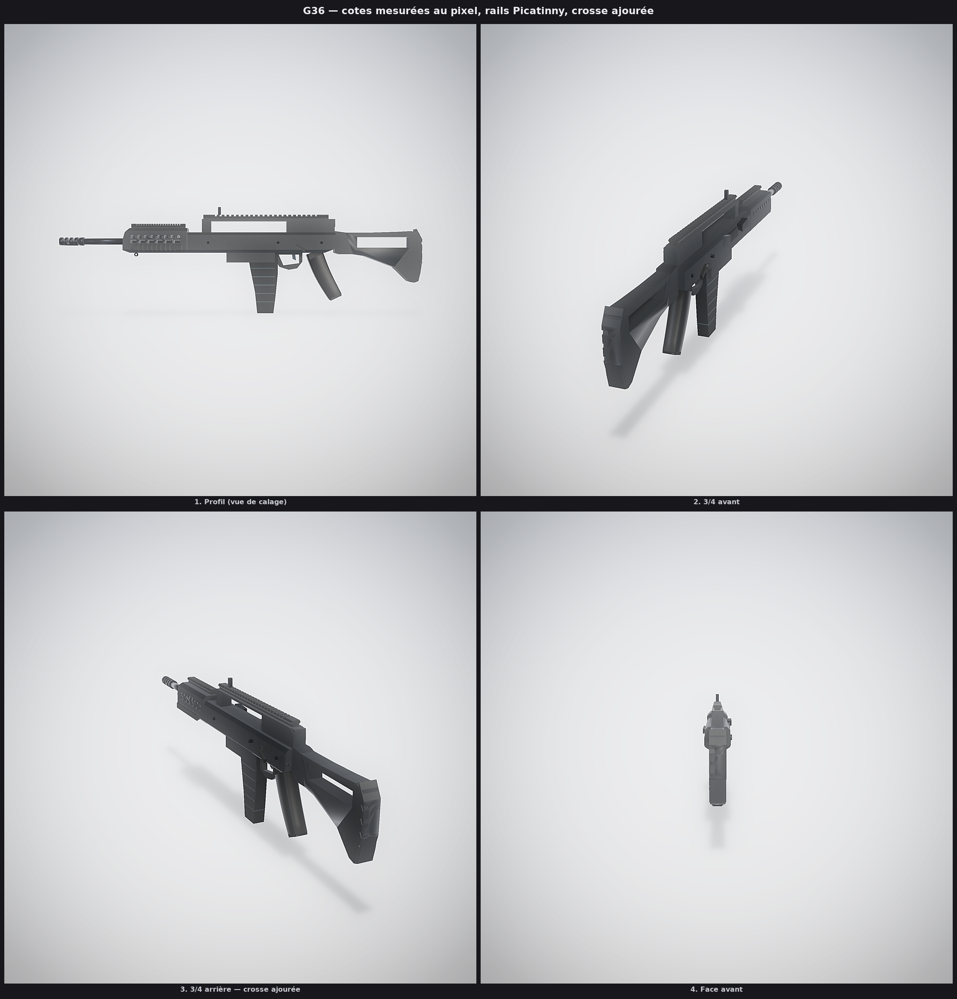
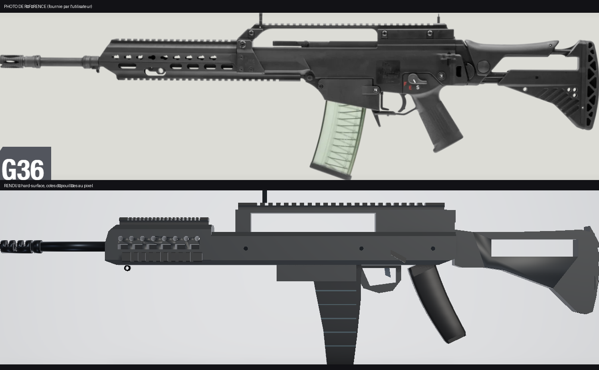

# G36 — Heckler & Koch G36 (5,56 × 45 mm), hard-surface

Modèle game-ready reconstruit en **hard-surface** et calé au pixel sur une vue de
profil photographique. Référence : version à **rails Picatinny intégrés**,
chargeur fumé, crosse ajourée.





## Méthode

Chaque pièce est un prisme extrudé : **silhouette anguleuse** en (y, z) ∩
**section chanfreinée** en (x, z). Les chanfreins font 7,5 à 8 mm — c'est ce qui
donne la finesse du polymère moulé. Un chanfrein à 45° sépare deux faces de
`cos 45° = 0,707`, sous le seuil de lissage du renderer (0,72) : arêtes franches
sans dupliquer un seul sommet.

## Cotes mesurées

Dépouillement de la photo : **masque binaire** (seuillage + fermeture
morphologique), détection de la composante connexe principale, échelle
998 mm / 1276 px, axe du canon à 29 % de la hauteur. Contour externe par balayage
colonne par colonne, puis remplissage des trous pour obtenir les lumières
intérieures.

| Repère | Mesuré |
|---|---|
| Longueur / hauteur | 998 × 279 mm (**L/H 3,574**, contre 3,23 avant — le modèle était trop haut) |
| Garde-main | y +318 → +143, dessus +36, dessous −31 |
| Rail haut cranté | +61 de haut, de y +100 à −244, **22 dents** |
| Fenêtre de poignée | **208 × 32 mm** (y +79 → −129, z +24 → +56) |
| Boîtier | dessus +24, dessous −31 |
| Chargeur | 84 mm de large, pointe à **−197** (point le plus bas) |
| Poignée pistolet | y −204 → −262, bas à −150 |
| Pontet | bas à −78, boucle ajourée |
| Crosse | dessus +21…+35, talon à −113, **fenêtre 144 × 29 mm** |

## Ce qui est modélisé

| Zone | Détail |
|---|---|
| Garde-main | nez biseauté, **2 rangées d'ouïes** (8 trous ronds + 6 lumières oblongues traversantes), rail supérieur 19 dents, rail latéral |
| Poignée de transport | pilier avant, poutre, bloc arrière — fenêtre traversante mesurée |
| Boîtier | chanfreins 7,5 mm, puits de chargeur, fenêtre d'éjection, déflecteur, 3 goupilles |
| Crosse | cadre ajouré, **disque de charnière**, plaque de couche à échelles triangulaires |
| Chargeur | banane inclinée vers l'avant, nervures transversales, matière fumée |
| Canon | Ø 17 mm, frein de bouche **ajouré de 6 fentes + âme débouchante** |
| Mécanique | sélecteurs ambidextres, poignée d'armement, grenadière |

## Preview temps réel

```bash
python3 preview/serve_preview.py --port 8000   # -> http://localhost:8000
```

Visualiseur WebGL (three.js vendorisé, zéro CDN) : orbite, bascule LOD0/1/2,
arêtes franches, sockets, colliders UCX. Le mode **comparaison** superpose la
photo de référence à la silhouette 3D — c'est le contrôle qui manquait.

## Lancer la génération

```bash
python3 scripts/turbo_forge.py g36 -o exports/g36 --target hero --tex-size 2048
```

Contrôle de la géométrie :

```bash
PYTHONPATH=scripts python3 examples/g36_rifle/build_g36.py
# 29 pièces · 3 998 tris · dims [0.084, 0.995, 0.2915] · non étanches : aucune
```

## Livrables (`exports/g36_rifle/`)

| Fichier | Contenu |
|---|---|
| `g36_rifle_game.glb` | LOD0 — **4 150 tris**, 3 draw calls |
| `g36_rifle_LOD1.glb` / `_LOD2.glb` | 2 816 / 1 834 tris |
| `g36_rifle_colliders.glb` | 6 hulls UCX |
| `roblox/` | GLB + PNG 1024², script Luau |
| `unreal/` | `SM_g36_rifle.glb` + BC / ORM / N (DirectX −Y) 2048² |
| `g36_rifle.zip` | paquet complet |

`python3 scripts/gates.py exports/g36_rifle --target hero` → **24/24**.

## Notes d'implémentation

- `mk.place()` ancre les boîtes **par la base en Z** mais centre en X/Y — un oubli
  fait dépasser une pièce de 20 mm.
- `mk.extrude()` base à z = 0, extrusion vers +Z : les transformations maison
  (`_M_X`, `_M_Y`) doivent compenser l'offset.
- `gr.picatinny_rail()` : axe long en Y, **base à z = 0**.
- Le renderer cadre sur la sphère englobante : sous fov 38° une arme de 1 m est
  rognée. Utiliser fov 44° pour le profil complet.
- Les « ailes » étranges vues en passe 2 n'étaient pas de la géométrie : c'était le
  cadrage qui coupait la crosse au bord de l'image.
