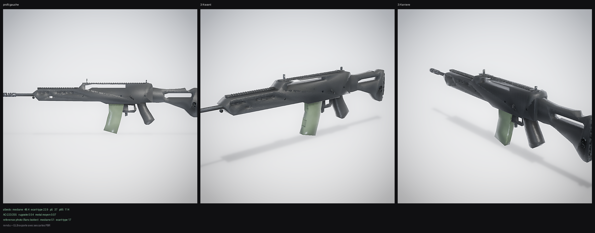

# G36 — Heckler & Koch G36 (5,56 × 45 mm), hard-surface

Modèle game-ready reconstruit en **hard-surface** et calé au **millimètre** sur une
vue de profil photographique. Référence : version à **rails Picatinny intégrés**,
**chargeur translucide vert**, crosse ajourée à talon galbé.




**IoU de silhouette 0,928** · erreur de contour **1,5 mm en haut / 1,4 mm en bas**
sur une arme de 277 mm de haut — soit 0,5 % de la hauteur.
**Albédo médian 48,4** pour **51** mesurés sur la photo (écart 5 %).

## Méthode

Chaque pièce est un prisme extrudé : **silhouette anguleuse** en (y, z) ∩
**section chanfreinée** en (x, z). Le profil n'est pas dessiné à l'œil : il est
**relevé sur le masque binaire de la photo**, colonne par colonne, puis
reconverti en millimètres.

Le contrôle de ressemblance (`refcheck.py`) compare deux silhouettes
**orthographiques** rastérisées à **1 px = 1 mm**. C'est le point qui a coûté le
plus cher : un rendu en caméra *perspective* déplace les bords de 1 à 3 mm sur
une arme de 61 mm de large vue à 1,1 m, et fait croire à des erreurs de géométrie
qui n'existent pas.

## Cotes mesurées

Masque : distance à la couleur du fond > 8, fermeture 3 × 3, composante
connexe principale. Échelle **998 mm / 1276 px**, axe du canon à 29 % de la
hauteur du cadre.

| Repère | Mesuré photo | Modèle |
|---|---|---|
| Longueur × hauteur | 998 × 278 mm (L/H **3,59**) | 996,5 × 276,6 mm (3,60) |
| Garde-main | y +336 → +115, dessus +28, rail +36,8 | idem |
| Rail haut cranté | +61,0, de y +112 à −244 | idem, 30 dents |
| Fenêtre de poignée | 205 × 27 mm (y +76 → −129, z +26 → +53) | tracée sur 8 sommets |
| Boîtier | dessus +54, dessous −30 puis **−46** (logement de détente) | idem |
| Ouïes du garde-main | 7 + 2, z +8 / −19, pas de 20 mm | poches 20 × 10 + lumière traversante |
| Chargeur | face avant raide, pointe à **−196**, talon en biais | banane 12 sommets |
| Poignée pistolet | y −182 → −273, pointe à **−151** | relevé tous les 10 mm |
| Pontet | plancher à −89, ouverture y −140 → −171, détente à −108 | idem |
| Crosse | fenêtre **142 × 28 mm**, dessous −39…−113 | idem |
| Talon | galbe : 148 mm de haut à −486, 65 mm à −498 | arc de 12 sommets |
| Frein de bouche | y +434 → +499 | idem |

## Ce qui est modélisé

| Zone | Détail |
|---|---|
| Garde-main | nez biseauté, **7 ouïes + 2 lumières** mesurées au pixel, rail 18 dents, ouïes en poches latérales |
| Poignée de transport | pilier, poutre, rampe avant **courbe** (mesurée : +36 à +105, +42 à +100, +52 à +90, +56 à +80) |
| Boîtier | fenêtre d'éjection, déflecteur, 3 goupilles, logement de détente en marche à −46 |
| Crosse | cadre ajouré, disque de charnière, plaque de couche à **échelles fines** |
| Chargeur | polymère **translucide vert pâle** (opacité 0,62, transmission 0,35), nervures |
| Canon | Ø 15 mm, frein ajouré à 6 fentes + âme débouchante |
| Mécanique | sélecteurs ambidextres, poignée d'armement, grenadière au nez |

## Contrôler la ressemblance

```bash
PYTHONPATH=scripts python3 examples/g36_rifle/build_g36.py     # 25 pièces · 3 836 tris
PYTHONPATH=scripts python3 examples/g36_rifle/refcheck.py      # IoU + écarts par colonne
PYTHONPATH=scripts python3 examples/g36_rifle/compare_reference.py
```

`refcheck.py` écrit `refcheck_overlay.png` (rouge = manquant, bleu = en trop) et
affiche l'écart haut/bas toutes les 25 mm. Seuils actuels : **toutes les colonnes
sous 6 mm, moyenne 1,5 mm**.

## Export

```bash
PYTHONPATH=scripts python3 - <<'EOF'
import importlib.util, game_ready as gr
spec = importlib.util.spec_from_file_location("g36", "examples/g36_rifle/build_g36.py")
m = importlib.util.module_from_spec(spec); spec.loader.exec_module(m)
gr.export_game_package(m.build(), out_dir="exports/g36_rifle", name="g36_rifle",
                       engine="roblox_unreal", lod0_tris=9200, tex_size=2048,
                       joint_tex_size=1024, weathering=0.30)
EOF
python3 scripts/gates.py exports/g36_rifle --target hero   # 24/24
```

## Preview temps réel

```bash
python3 preview/serve_preview.py --port 8000   # -> http://localhost:8000
```

Visualiseur WebGL (three.js vendorisé, zéro CDN) : orbite, bascule LOD0/1/2,
arêtes franches, sockets, colliders UCX, mode comparaison avec la photo.

## Livrables (`exports/g36_rifle/`)

| Fichier | Contenu |
|---|---|
| `g36_rifle_game.glb` | LOD0 — **3 812 tris**, **2 draw calls** (le chargeur translucide est un matériau à part) |
| `g36_rifle_LOD1.glb` / `_LOD2.glb` | 2 592 / 1 684 tris |
| `g36_rifle_colliders.glb` | 6 hulls UCX, 218 tris |
| `roblox/` | GLB + PNG 1024², script Luau |
| `unreal/` | `SM_g36_rifle.glb` + BC / ORM / N (DirectX −Y) 2048² |
| `g36_rifle.zip` | paquet complet |

Sockets : `muzzle`, `grip`, `optic`, `eject`, `mag`, `rail_top`, `rail_bottom`,
`stock`, `origin_ground`, `top`, `interact`.

## Notes d'implémentation

- **Ne jamais mesurer la silhouette avec une caméra perspective.** À 61 mm de
  large, les bords bougent de 1 à 3 mm et l'IoU perd 6 points.
- **Le chargeur est translucide** : un seuil de luminance le troue (25 % de son
  aire), et l'on croit alors que le modèle a un excès de matière. Le masque doit
  se faire par **distance à la couleur du fond**, jamais par luminosité seule —
  mais pas trop près non plus, sinon l'ombre portée sous le canon entre dans le
  masque (+900 mm² d'aire fantôme).
- `mk.place()` ancre les boîtes **par la base en Z** mais centre en X/Y ; un oubli
  fait dépasser une pièce de 20 mm.
- `mk.extrude()` base à z = 0, extrusion vers +Z : `_M_X` / `_M_Y` compensent.
- `gr.picatinny_rail()` : axe long en Y, base à z = 0. Ses dents descendent sous
  la base — au-dessus d'une fenêtre il faut **rogner les dents**, pas décaler le
  rail.
- Le renderer cadre sur la sphère englobante : à fov 32° une arme de 1 m remplit
  le cadre ; à fov 14° on ne voit qu'une moitié.
- Les « facettes diagonales » vues en 3/4 sur le garde-main ne sont **pas** de la
  géométrie : c'est l'ombre du rail projetée sur le flanc.

## Matériaux et textures

Le rendu du `Builder` nu ne dit **rien** des textures : ni la patine, ni
l'albédo, ni l'ORM. `material_sheet.py` rend donc le **GLB exporté** et mesure
ses cartes. C'est là que trois défauts sont apparus, invisibles au contrôle de
silhouette :

| Défaut | Mesure avant | Correction |
|---|---|---|
| Rails en **polymère** classés « acier brossé » | brossage anisotrope + éclats d'acier sur une pièce moulée | `classify_material_id` respecte d'abord `metallic` du matériau |
| Acier **phosphaté** usé à l'acier nu | p95 d'albédo **138** pour une photo à 75 | un métal sombre s'use en s'éclaircissant, pas en virant au chrome |
| Grain triplanaire sur grande face plane | écart-type d'albédo **22,9** pour 17 en photo | amplitude du grain bornée à 0,055 sur les non-métaux |
| Crème / crasse d'AO sur l'union CSG | taches molles lisant comme un camouflage | `dirt_amount` / `grime_amount` exposés par export (0,10 / 0,06 ici) |
| Teintes deux fois trop sombres | `#191d20` = luminance 28 | recalées sur la photo : polymère 58-65, dessus 48, rail 82 |
| Chargeur qui se délavait | transmission 0,35 + fond clair | polymère **opaque** vert olive ; la translucidité est suggérée par les nervures |

Les cartes sont écrites en 2048² (Unreal : BC / N / N_gl DirectX −Y / ORM ;
Roblox : ColorMap 1024², Normal, Roughness, Metalness séparées).

## Détails ajoutés sur cette passe

- **sélecteur** affleurant : disque 14 mm + pivot 10 mm + bras coudé. La version
  précédente sortait de 6 mm et lisait comme une excroissance sombre en 3/4.
- **anneaux de grenadière** avant et arrière, avec support **percé** d'un vrai
  trou de 4,6 mm — un anneau non percé lit comme une rondelle collée.
- **gravure longitudinale du rail** : quatre stries de 0,6 mm sur les joues, ce
  qui fait lire une Picatinny usinée plutôt qu'un bloc lisse.

Les marquages **F / E / S** du boîtier ont été modélisés puis **retirés** : à
2 mm de haut, ils sont dévorés par la résolution de l'atlas UV (mesuré : 3 × 3
texels). Sur un vrai pipeline ils appartiennent à un décalque séparé, pas à la
géométrie ni à l'atlas commun.

## Détails de la passe suivante

Relevés un par un sur des zooms de la photo, pas devinés :

- **rail inférieur court** sous l'avant du garde-main — dents de z −27,8 à −30,9,
  pas de 11 mm, de y +250 à +305. Il manquait complètement, et c'est une des
  signatures visuelles du G36 à rails. Construit à la main : un Picatinny
  « retourné » verrait ses dents vers le haut.
- **treillis du talon** : 10 losanges en creux (pas de 11,3 mm) sur les deux
  joues, y −470…−490. Ce sont des **poches borgnes**, pas des jours — sur la
  photo elles restent sombres alors que le fond est clair. Première tentative à
  2,6 mm de profondeur : le motif disparaissait sous l'ombrage, ramené à 1,2 mm.
- **3 trous de grenadière** traversants dans la crosse (6 × 8 mm) + la petite
  goupille de z −90, aux positions mesurées.
- **douille QD** de 14 mm sur les deux flancs du garde-main (boulon cerclé d'une
  cuvette), à y +245, z −16.
- **collier de canon** de 24 mm à y +310.
- **grenadière avant** replacée à y +330 : je l'avais d'abord déplacée à +350,
  soit 20 mm trop en avant, en lisant mal l'échelle du zoom.

La plaque de couche a été **simplifiée** : les cylindres à 3 sections qui
figuraient les « échelles » lisaient comme des dents de peigne et bavaient à
l'export. Le treillis mesuré est maintenant taillé dans la crosse, là où il est
vraiment.

Vérifications : 36 pièces · 6 300 tris · watertight · IoU **0,9282** ·
erreur de contour **1,5 mm / 1,5 mm** · LOD0 **6 336** / 4 290 / 2 800 ·
1 draw call · 6 UCX · 11 sockets · portes **24/24** · pytest **70 passed**.

## Passe de propreté

Quatre défauts vus seulement en regardant le GLB de près (rendu 1400 px,
recadré), pas dans la planche à taille normale.

- **Le grain triplanaire faisait des taches.** Les scans de matière étaient
  filtrés avec un passe-bas à `taille/9` : ils gardaient leur marbrures de
  quelques centimètres, que la projection triplanaire ressortait en plaques
  molles sur les flancs — et l'échantillonnage au plus proche voisin en
  escalier les bords. Passe-bas à `taille/22` + échantillonnage bilinéaire :
  le grain redevient du grain. C'était **la** cause des « coulures » qu'on
  prenait pour de la patine.
- **Fentes du rail RE-CALÉES SUR LE MIL-STD-1913.** Rail de 9,5 mm, fente de
  3,2 mm de profondeur et 5,35 mm de large pour un pas de 10 mm. Au passage,
  un piège : `mk.box` est posé sur `z = 0` et non centré en Z — une fente
  placée à 0,95 H flottait au-dessus du rail et la différence ne retirait
  rien. Les 18 îlots de dents sont maintenant vérifiés au maillage, pas à
  l'œil.
- **Bord du talon en dents de scie.** Les pointes arrière des losanges du
  treillis dépassaient la face du talon de 0,4 mm et mordaient dans la plaque
  de couche. Motif recentré de 3 mm : les pointes s'arrêtent 0,5 mm avant le
  bord.
- **Hausses en carton.** Les mires n'étaient qu'une plaque de 7 mm d'épaisseur
  plantée sur le rail. Remplacées par de la vraie mécanique : embase chanfrée
  + deux oreilles de protection + lame fine à l'avant, bloc à cran de mire en
  U à l'arrière. Sommets de silhouette conservés (+80,6 / +75,1), d'où un IoU
  qui bouge de 0,0006 — on perd six dix-millièmes de silhouette pour une pièce
  qui ressemble à quelque chose.

Vérifications : 36 pièces · 6 312 tris · watertight · IoU **0,9282** ·
erreur de contour **1,6 mm / 1,5 mm** · LOD0 **6 336** / 4 290 / 2 800 ·
1 draw call · 6 UCX · 11 sockets · portes **24/24** · pytest **70 passed**.

## Maillage haute densité (hero)

Le GLB de jeu fait 6 336 triangles : c'est la bonne résolution pour du temps
réel, c'est trop peu pour une image fixe. `build_hero.py` en dérive un maillage
lourd **dans la fourchette demandée (1 000 000 – 10 000 000 de faces)** :

| | jeu | hero |
|---|---|---|
| faces | 6 336 | **1 622 016** |
| sommets | 4 090 | 874 586 |
| GLB | 1,9 Mo | 50,6 Mo |
| watertight (sommets soudés) | oui | oui |

Méthode, dans cet ordre :

1. **subdivision 1→4, quatre passes** (×256) avec interpolation des UV au
   milieu des arêtes. L'atlas 2048 reste *exactement* le même : aucun
   redépliage, aucune recuisson, donc aucune dérive de teinte entre les deux
   versions ;
2. **lissage Taubin avec arêtes vives épinglées**. On calcule l'angle dièdre de
   chaque arête ; au-delà de 52° (dents de rail, chants, faces de culasse) les
   sommets sont figés, en dessous (chanfreins, congés, cylindres) la surface
   est lissée. Résultat : 59 479 sommets figés sur 810 961 — les congés
   deviennent de vrais rayons au lieu d'une facette de 45° ;
3. **normales calculées sur les sommets soudés par position**, puis
   redistribuées aux copies de couture UV, et exportées (`include_normals`).
   Sans ça, chaque frontière d'îlot de l'atlas réapparaît en pli sombre.

Deux choses ont dû être corrigées en route, et méritent d'être notées :

- **la carte de normales est retirée du hero.** Elle est cuite en espace tangent
  sur le maillage à 6 336 triangles ; ses frontières d'îlots portent un saut de
  trame de tangente. Sur le maillage de jeu, les facettes le masquent ; dès que
  l'ombrage devient lisse, il ressort en longues coutures sombres en travers
  des flancs (un filtre médian 5×5 sur la carte ne les enlève pas : ce n'est
  pas un défaut de bord, c'est une rotation de repère par îlot). À 1,6 M de
  triangles, la géométrie porte le relief, on ne garde que l'albédo et l'ORM ;
- **le compte de faces est vérifié par le script** : hors de la fourchette, il
  sort en code 2. Un `--subdiv 2` (101 376 faces) échoue volontairement, c'est
  le test du garde-fou.

Pourquoi pas 10 M : au-delà de ~2 M, les faces supplémentaires ne font que
décrire la même surface — c'est la texture 2048 (≈ 2 mm par texel) qui borne
la finesse visible. Le budget reste dans la fourchette demandée, sans gonfler
le fichier à 300 Mo pour du vide.

`hero_compare.png` place les deux maillages côte à côte, mêmes vues, même
éclairage ; le cadrage serré du bas montre les ouïes et le rail. Dans la
preview, le bouton **HERO** charge le maillage lourd à la demande (50 Mo).
